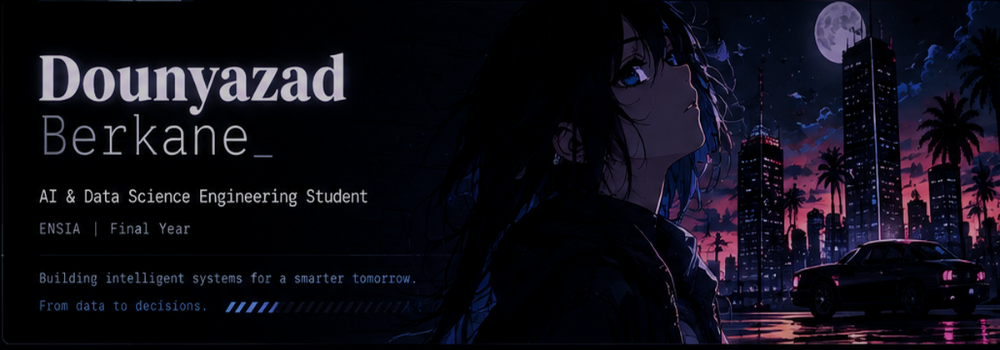
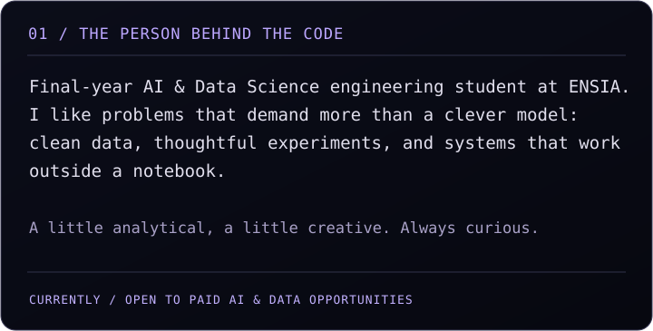
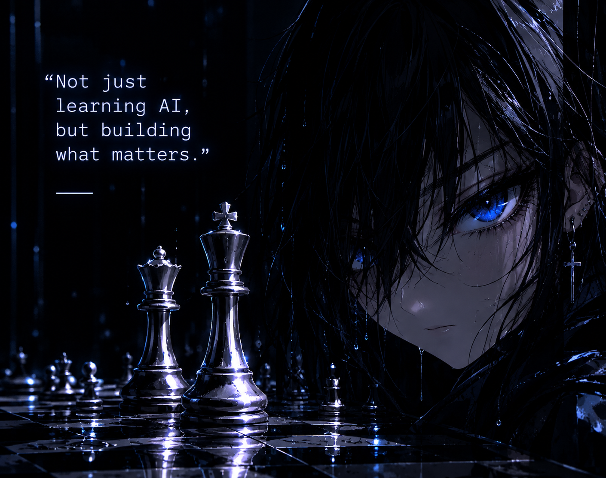
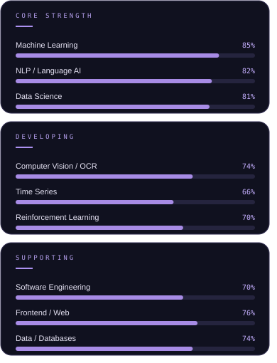

 

A I &nbsp;&nbsp; / &nbsp;&nbsp; D A T A &nbsp; S C I E N C E &nbsp;&nbsp; / &nbsp;&nbsp; E N S I A

  

 

 

ALGIERS, ALGERIA &nbsp;|&nbsp; FINAL YEAR AT ENSIA

  

<!-- ABOUT -->

 

 

THE TOOLS BEHIND THE THOUGHT PROCESS

 

 

<!-- CHESS ART -->

  

STRATEGY IS A FORM OF THINKING.

  

<!-- CURRENT FOCUS -->

WHERE MY CURIOSITY IS TAKING ME

  

 

Every skill begins with curiosity. Every experiment is another move on the board.

  

<!-- GITHUB STATS -->

THE QUIET WORK BEHIND THE SCREEN

  

 

<!-- These third-party cards may be rate limited or unavailable; the rest of the README works without them. -->

  

FEEL FREE TO REACH OUT

  

  

GOOD THINGS TAKE TIME.

 

ALGIERS, ALGERIA 
D R E A M &nbsp;&nbsp; / &nbsp;&nbsp; C O D E &nbsp;&nbsp; / &nbsp;&nbsp; B U I L D

