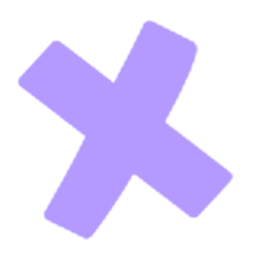
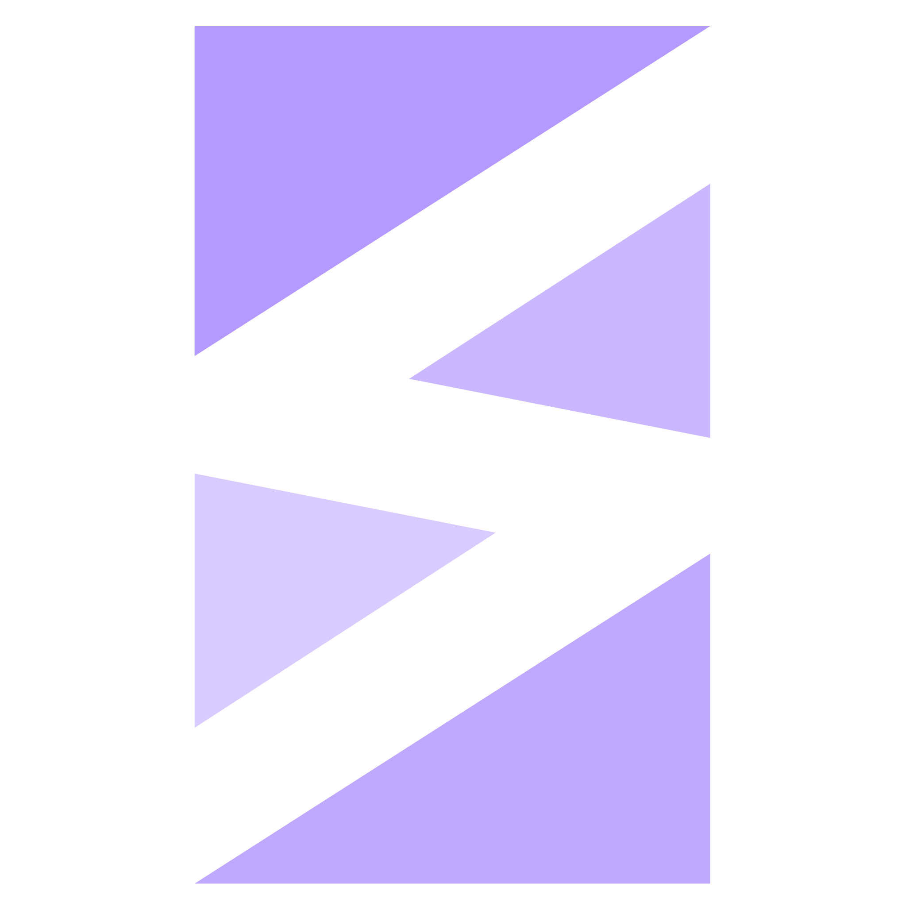
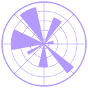

<!-- MIDNIGHT / THE QUEEN'S GAMBIT — Dounyazad Berkane -->

 

<!-- HERO: TEXT + LINKS (LEFT) | ROTATING 3D NEURAL FACE (TOP RIGHT) -->
<table align="center" width="100%">
<tr>

<td width="58%" align="center" valign="middle">

 

<!-- LINKS: they appear only here, once -->

  

ALGIERS, ALGERIA &nbsp;|&nbsp; FINAL YEAR AT ENSIA

  

W H A T &nbsp; I &nbsp; L O V E
 

</td>

<td width="42%" align="center" valign="middle">

</td>

</tr>
</table>

 

<table align="center" width="100%">
<tr>

<td width="28%" align="center" valign="middle">

 

</td>

<td width="44%" align="center" valign="middle">

<h2 align="center">F U N &nbsp; F A C T S &nbsp; A B O U T &nbsp; M E</h2>

<h3 align="center">I rarely laugh.</h3>

<h3 align="center">I like hackathons, competitions and research.</h3>

</td>

<td width="28%" align="center" valign="middle">

</td>

</tr>
</table>

 

  

 

  

<table width="100%">
  <thead>
    <tr>
      <th width="25%">Tools &amp; Technologies</th>
      <th width="75%">
        Icons 
        
      </th>
    </tr>
  </thead>
  
  <tr>
    <td><b>Languages</b></td>
    <td>
      &nbsp;
      &nbsp;
      &nbsp;
      &nbsp;
    </td>
  </tr>
  <tr>
    <td><b>ML / Deep Learning</b></td>
    <td>
      &nbsp;
      &nbsp;
      &nbsp;
      &nbsp;
      &nbsp;
      &nbsp;
    </td>
  </tr>
  <tr>
    <td><b>Data Science</b></td>
    <td>
      &nbsp;
      &nbsp;
      &nbsp;
      &nbsp;
    </td>
  </tr>
  <tr>
    <td><b>NLP &amp; LLMs</b></td>
    <td>
      &nbsp;
      &nbsp;
      &nbsp;
      &nbsp;
      &nbsp;
    </td>
  </tr>
  <tr>
    <td><b>Computer Vision / OCR</b></td>
    <td>
      &nbsp;
      &nbsp;
      &nbsp;
    </td>
  </tr>
  <tr>
    <td><b>Databases</b></td>
    <td>
      &nbsp;
      &nbsp;
      &nbsp;
      &nbsp;
    </td>
  </tr>
  <tr>
    <td><b>Development &amp; APIs</b></td>
    <td>
      &nbsp;
      &nbsp;
      &nbsp;
      &nbsp;
    </td>
  </tr>
  <tr>
    <td><b>Tools &amp; DevOps</b></td>
    <td>
      &nbsp;
      &nbsp;
      &nbsp;
      &nbsp;
      &nbsp;
    </td>
  </tr>
</table>

 

<table align="center" width="100%">
<tr valign="middle">

<td width="50%" align="center" valign="middle">

 

</td>

<td width="50%" align="center" valign="middle">

</td>

</tr>
</table>

 

<!-- GITHUB STATS -->

<table align="center" width="100%">
<tr>

<td width="22%" align="center" valign="middle">

</td>

<td width="56%" align="center" valign="middle">

</td>

<td width="22%" align="center" valign="middle">

</td>

</tr>
</table>

 

 

  

  

GOOD THINGS TAKE TIME.

 

ALGIERS, ALGERIA 
D R E A M &nbsp;&nbsp; / &nbsp;&nbsp; C O D E &nbsp;&nbsp; / &nbsp;&nbsp; B U I L D

