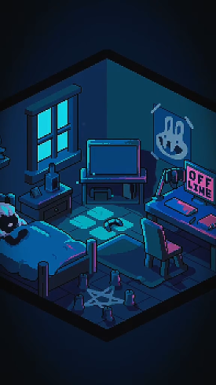
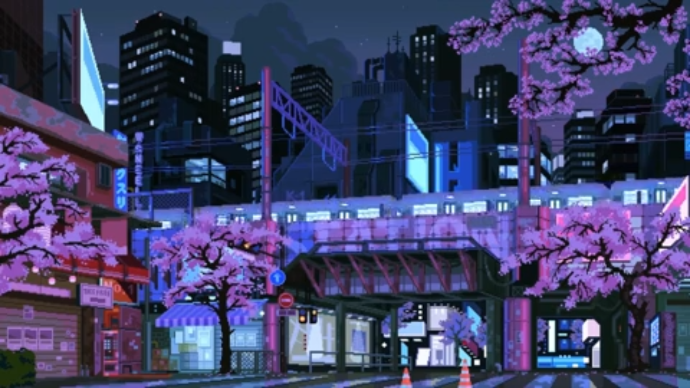

<!-- MIDNIGHT / THE QUEEN'S GAMBIT — Dounyazad Berkane -->

 

A I &nbsp;&nbsp; / &nbsp;&nbsp; D A T A &nbsp; S C I E N C E &nbsp;&nbsp; / &nbsp;&nbsp; E N S I A

  

 

  

ALGIERS, ALGERIA &nbsp;|&nbsp; FINAL YEAR AT ENSIA

  

D I D &nbsp; Y O U &nbsp; K N O W
 

  

<!-- SHOWCASE: no table, so no borders -->

  

<!-- FUN FACT: plain centered text, then the coffee photo right under it -->
F U N &nbsp; F A C T &nbsp; A B O U T &nbsp; M E
 
<b>I rarely laugh.</b>
 
I like hackathons, competitions and research.

  

  

<!-- ABOUT -->

  

 

 

  

<!-- CURRENT FOCUS: full width -->

 

  

  

<!-- BEHIND THE CODE -->

 

  

 

<!-- dark contribution graph (the old ghchart one had a white background) -->

<!-- These third-party cards may be rate limited or unavailable; the rest of the README works without them. -->

  

 
FEEL FREE TO REACH OUT

  

  

GOOD THINGS TAKE TIME.

 

 

ALGIERS, ALGERIA 
D R E A M &nbsp;&nbsp; / &nbsp;&nbsp; C O D E &nbsp;&nbsp; / &nbsp;&nbsp; B U I L D

