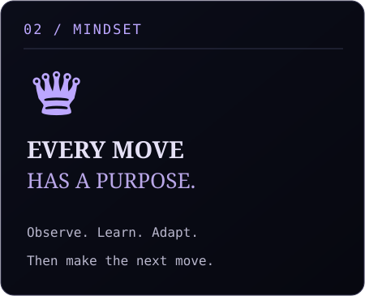
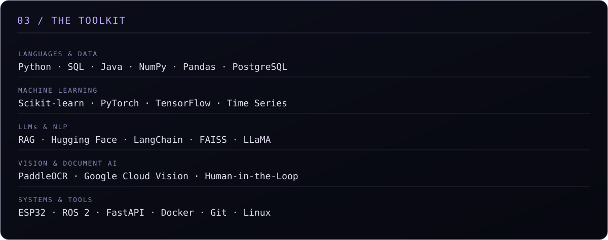
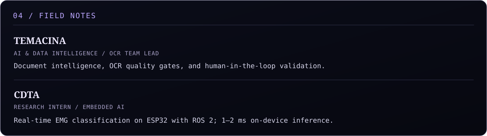
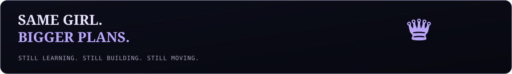

<!-- MIDNIGHT / THE QUEEN'S GAMBIT — Dounyazad Berkane -->

 

 

 

<table>
<tr>
<td width="62%" valign="top"></td>
<td width="38%" valign="top"></td>
</tr>
</table>

 

 

### `05 / ACTIVITY AFTER DARK`

<!-- These third-party cards may be rate limited or unavailable; the rest of the README works without them. -->

ALGIERS, ALGERIA &nbsp; / &nbsp; ENSIA &nbsp; / &nbsp; EST. 2022

